# Guia técnico e teórico

Este guia explica o estudo em profundidade, desde a construção das séries de preços até a comparação entre famílias de algoritmos e a interpretação dos resultados. O relatório consolidado, organizado pelos itens de avaliação, está em [`relatorio/RELATORIO.md`](../relatorio/RELATORIO.md). Os exemplos numéricos identificados como observados referem-se à execução `20261125_141318_918857_a808538b_comparacao`, descrita no [README principal](../README.md); outras execuções podem produzir resultados diferentes.

## 📚 Ordem de leitura

1. [Problema, dados e alvo](01-problema-dados-alvo.md): pergunta, qualidade dos dados, unidade de análise e definição do rótulo.
2. [Atributos e validação temporal](02-atributos-validacao-temporal.md): janela histórica, partições e prevenção de vazamento.
3. [Fundamentos dos modelos comparados](03-modelos-comparados.md): regressão logística, árvore, random forest, gradient boosting e por que a interpretação usa permutação.
4. [Pipeline e comparação de algoritmos](04-pipeline-e-selecao.md): transformações, as 24 configurações, critério de seleção, diagnóstico por família e escolha do limiar.
5. [Métricas, incerteza e resultados](05-metricas-e-resultados.md): matriz de confusão, intervalos por bootstrap de séries, significância sobre as referências e comparação entre famílias.
6. [Experimentos e reprodução](06-experimentos-reproducao.md): módulos, notebooks, artefatos, testes e procedimento de execução.
7. [Limitações e uso responsável](07-limitacoes-e-uso.md): pressupostos, vieses, conclusões permitidas e pontos a investigar.

## 🧭 Visão geral

```mermaid
flowchart LR
    accTitle: Fluxo da análise temporal
    accDescr: A fonte original passa por limpeza e construção histórica, seguida de comparação entre famílias de algoritmos com seleção temporal, avaliação única em teste e publicação dos artefatos no relatório.
    fonte["Planilha original"] --> limpeza["Limpeza e mediana mensal"]
    limpeza --> atributos["Atributos até o mês t"]
    atributos --> divisao["Partições por mês-alvo"]
    divisao --> selecao["24 configurações em 4 famílias; seleção só na validação"]
    selecao --> ajuste["Reajuste em treino e validação"]
    ajuste --> teste["Avaliação única no teste, com bootstrap de séries"]
    teste --> artefatos["Métricas, figuras e pipeline"]
    artefatos --> relatorio["relatorio/ versionado"]
```

O modelo estima a probabilidade de um aumento superior a 2%, e não o preço futuro ou o tamanho exato da mudança. A família vencedora é decidida por evidência na validação e pode mudar entre execuções. A documentação descreve o comportamento atual do código; consulte os arquivos de origem e os metadados de cada execução quando houver mudanças futuras.
