# Guia técnico e teórico

Este guia explica a regressão logística usada no estudo, desde a construção das séries de preços até a interpretação dos resultados. Os exemplos numéricos identificados como observados referem-se à execução `20261114_142933_489430_ab7cee47_logreg`, descrita no [README principal](../README.md); outras execuções podem produzir resultados diferentes.

## 📚 Ordem de leitura

1. [Problema, dados e alvo](01-problema-dados-alvo.md): pergunta, qualidade dos dados, unidade de análise e definição do rótulo.
2. [Atributos e validação temporal](02-atributos-validacao-temporal.md): janela histórica, partições e prevenção de vazamento.
3. [Fundamentos da regressão logística](03-regressao-logistica.md): probabilidade, logito, treinamento, regularização e interpretação dos coeficientes.
4. [Pipeline e seleção do modelo](04-pipeline-e-selecao.md): transformações, configurações, escolha do limiar e reajuste final.
5. [Métricas e interpretação](05-metricas-e-resultados.md): matriz de confusão, curvas, calibração e resultados reais.
6. [Experimentos e reprodução](06-experimentos-reproducao.md): módulos, notebooks, artefatos, testes e procedimento de execução.
7. [Limitações e uso responsável](07-limitacoes-e-uso.md): pressupostos, vieses, conclusões permitidas e pontos a investigar.

## 🧭 Visão geral

```mermaid
flowchart LR
    accTitle: Fluxo da análise temporal
    accDescr: A fonte original passa por limpeza e construção histórica, seguida de treino e seleção temporal, avaliação em teste e armazenamento de artefatos.
    fonte["Planilha original"] --> limpeza["Limpeza e mediana mensal"]
    limpeza --> atributos["Atributos até o mês t"]
    atributos --> divisao["Partições por mês-alvo"]
    divisao --> selecao["Treino e seleção na validação"]
    selecao --> ajuste["Reajuste em treino e validação"]
    ajuste --> teste["Avaliação no teste"]
    teste --> artefatos["Métricas, figuras e pipeline"]
```

O modelo estima a probabilidade de um aumento superior a 2%, e não o preço futuro ou o tamanho exato da mudança. A documentação descreve o comportamento atual do código; consulte os arquivos de origem e os metadados de cada execução quando houver mudanças futuras.
