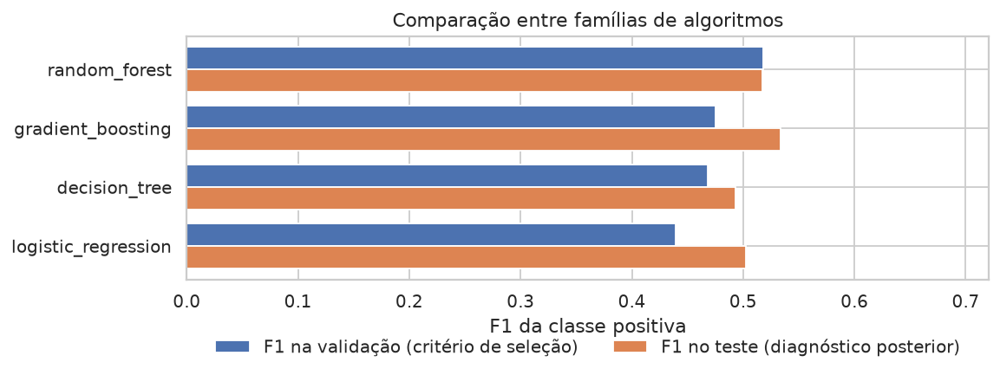
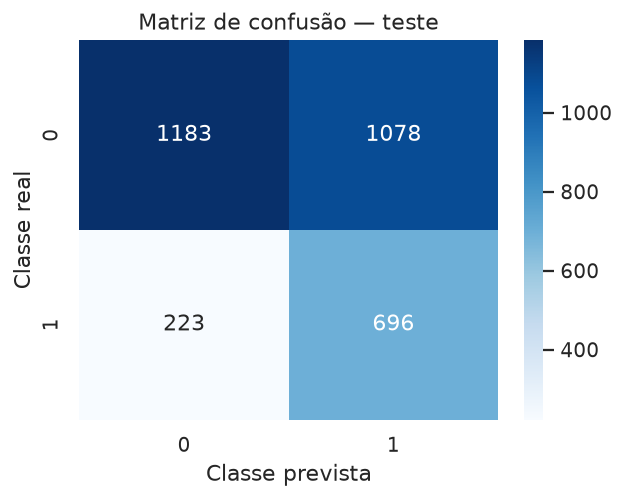
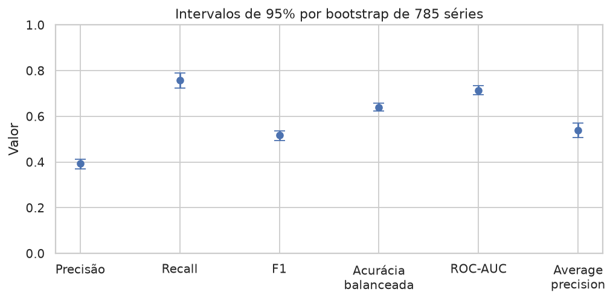
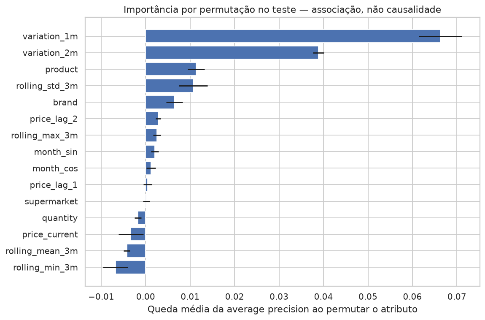
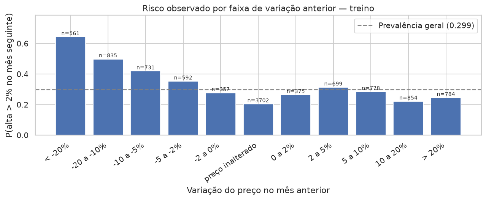
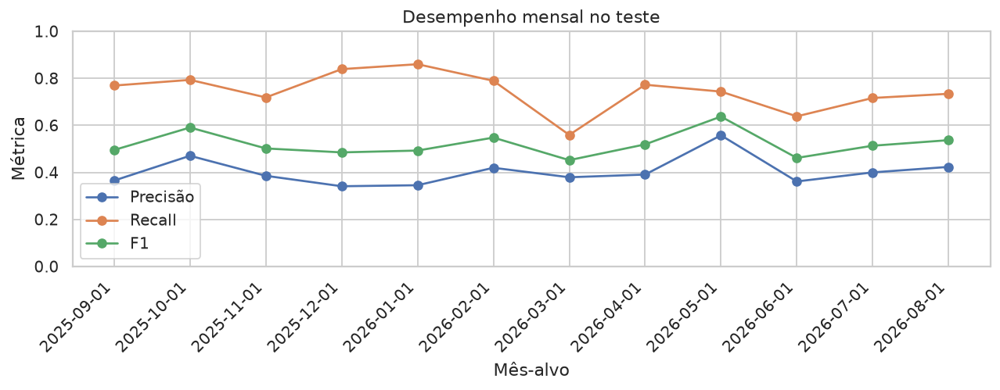
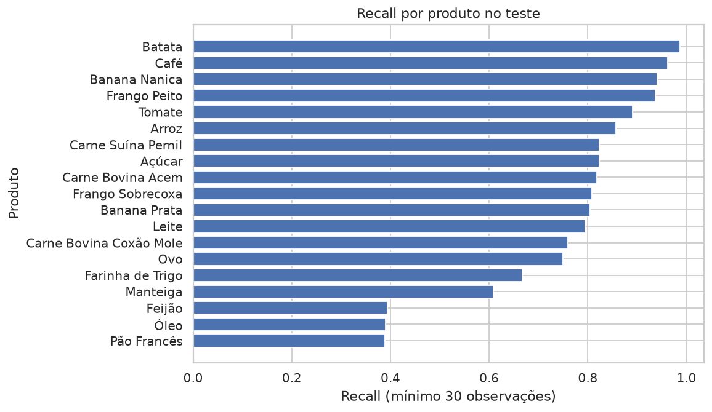
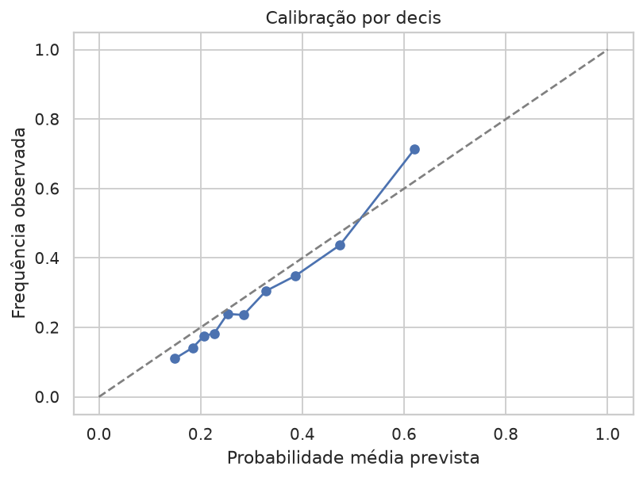

# Previsão de altas de preço na cesta básica

**Disciplina:** Sistemas Inteligentes e Aprendizado de Máquina (13134) · **Trabalho 2 (extensão)**\
**Professor:** Fernando Soares de Aguiar Neto

**Integrantes:**

- Gabriel Cattuzo — RA 24015324
- Guilherme Dias Cavalheri — RA 24013423
- Miguel Gengo — RA 24009007

**Base:** `ICB_DADOS_2026.xlsx`, aba `ACUMUL_DESAGREG` — 46.264 coletas de preço em 51 estabelecimentos e 30 produtos, de setembro/2022 a agosto/2026.\
**Execução documentada:** `20261125_141318_918857_a808538b_comparacao`. Todas as figuras e tabelas citadas estão em `figuras/` e `tabelas/`, copiadas dessa execução por `publish_report_assets`.

---

## 1. Questão

> **Os preços passados de um item, em um supermercado específico, permitem prever se aquele mesmo item ficará mais de 2% mais caro no mês seguinte?**

Cada exemplo é uma série `(supermercado, produto, marca, quantidade)` observada em um mês `t`. A saída é a probabilidade de que `P(t+1) / P(t) − 1 > 0,02`. O modelo não estima o preço futuro nem o tamanho da alta — apenas o risco de o item cruzar esse limite.

### Por que 2%

O corte de 2% define o evento de interesse. A distribuição das 17.002 transições mensais elegíveis dá contexto à escolha.

| Faixa de variação mensal | Participação |
| --- | ---: |
| Queda maior que 2% | 27,3% |
| Estável, dentro de ±2% | **43,5%** |
| Alta maior que 2% | 29,2% |

A mediana da variação mensal foi zero. Em 36,4% das transições o preço ficou exatamente igual. O corte permite estudar altas acima de uma margem definida, enquanto 43,5% das transições ficaram na faixa de ±2%.

---

## 2. Objetivo e Motivação

### Objetivo

Avaliar se um modelo que usa o histórico recente de preços e as características de cada série antecipa altas relevantes, e quantificar o desempenho para informar o possível uso de alertas.

### Motivação e aplicação esperada

A cesta básica consome a maior fatia do orçamento de famílias de baixa renda, e essas famílias são exatamente as que têm menos capacidade de antecipar compras ou comparar estabelecimentos. A pesquisa de preços que gera esta base já existe e já é pública; o que não existe é uma leitura **prospectiva** dela. Hoje a pesquisa informa o que já aconteceu com os preços.

O conhecimento produzido aqui tem dois destinatários diretos:

1. **Organizações de assistência alimentar e compras coletivas** (bancos de alimentos, cozinhas comunitárias e associações de bairro), que podem usar o alerta para avaliar se vale antecipar a compra de um item.
2. **Programas de educação financeira e defesa do consumidor** (Procon, extensão universitária), que podem usar o modelo para dirigir a atenção aos itens e estabelecimentos de maior risco de alta no mês, em vez de tratar a cesta inteira de maneira uniforme.

Um alerta pode ajudar a priorizar o acompanhamento de itens ou a planejar compras. A importância de cada tipo de erro depende da aplicação e dos custos de estoque, capital de giro e compra. A base permite contar falsos alertas e altas sem alerta. A avaliação do custo financeiro exigiria dados adicionais.

### Critério de avaliação

A avaliação compara o F1 com a regra de repetir a alta anterior e a acurácia balanceada com a regra de nunca emitir alerta. Os intervalos de 95% das diferenças, estimados por bootstrap pareado por série, indicam se houve ganho nas métricas avaliadas sob esse esquema de reamostragem.

---

## 3. Método

### 3.1 Dos registros brutos às séries

| Etapa | Registros |
| --- | ---: |
| Coletas originais | 46.264 |
| Após remover 1.743 duplicatas integrais | 44.521 |
| Observações mensais após agregação | 43.948 (em 4.216 séries) |

A unidade de análise é a série **`(supermercado, produto, marca, quantidade)`** — comparar o preço da *mesma embalagem* consigo mesma. Isso evita que a troca de um pacote de 1 kg por um de 5 kg apareça como variação de preço. Quando há mais de uma coleta da mesma série no mesmo mês, usa-se a **mediana**, que limita a influência de uma coleta extrema sem exigir uma regra de exclusão arbitrária. Marca ausente vira categoria explícita `(não informada)`, nunca imputação.

Nenhum preço é interpolado. Lacunas na série são **excluídas**, não preenchidas — preencher criaria variações que ninguém observou.

### 3.2 Alvo e elegibilidade

Exige-se histórico consecutivo em `t`, `t−1` e `t−2` e preço observado no mês-calendário `t+1`:

| Filtro | Observações |
| --- | ---: |
| Observações mensais | 43.948 |
| Sem preço no mês-calendário seguinte (sem alvo) | −15.108 |
| Com alvo, mas sem histórico de 2 meses | −11.838 |
| **Exemplos elegíveis** | **17.002** |

A comparação `> 0,02` é estrita, com tolerância de `1e-12` para erro de ponto flutuante: uma alta de exatamente 2% é classe 0. Há teste automatizado para esse limite (`tests/test_features.py::test_strict_target`).

### 3.3 Validação temporal e prevenção de vazamento

A divisão é feita **pelo mês-alvo**, não pelo mês dos atributos — um exemplo cujo alvo é setembro/2025 pertence ao teste mesmo que seus atributos venham de agosto/2025.

| Partição | Mês-alvo | Exemplos | Altas |
| --- | --- | ---: | ---: |
| Treino | set/2022 – dez/2024 | 10.268 | 3.068 (29,9%) |
| Validação | jan/2025 – ago/2025 | 3.554 | 970 (27,3%) |
| Teste | set/2025 – ago/2026 | 3.180 | 919 (28,9%) |

Quatro barreiras contra vazamento, todas verificadas por teste automatizado:

1. Os *lags* só são aceitos se a **diferença de calendário** for exatamente 1 e 2 meses. Uma observação de janeiro nunca é tratada como "mês anterior" de março.
2. `P(t+1)`, a variação real e o alvo **não estão na lista de atributos**; alterar o preço futuro não altera nenhum atributo de `t`.
3. `select_model` recebe apenas treino e validação — há teste que inspeciona a assinatura da função para garantir que o teste não pode entrar.
4. `StandardScaler` e `OneHotEncoder` vivem **dentro** do `Pipeline`, ajustados só no conjunto de ajuste. Categorias inéditas no teste viram zeros, não erro.

### 3.4 Algoritmos comparados

Quatro famílias com vieses indutivos diferentes, todas sobre o mesmo pré-processamento:

| Família | Configurações | Por que está na comparação |
| --- | ---: | --- |
| Regressão logística | 6 | Fronteira linear no logito; coeficientes interpretáveis; linha de base paramétrica |
| Árvore de decisão | 6 | Captura interações e não linearidades com um modelo único e legível |
| Random forest | 8 | Reduz a variância da árvore por agregação; robusta a atributos correlacionados |
| Gradient boosting (histograma) | 4 | Ajusta resíduos sequencialmente; costuma dominar em dados tabulares |

**24 ajustes × 17 limiares (0,10 a 0,90) = 408 candidatos avaliados.** Só o modelo linear recebe `StandardScaler`; árvores são invariantes a transformação monotônica dos atributos, e padronizá-las seria ruído metodológico.

### 3.5 Critério de seleção

Um único critério, aplicado ao conjunto todo e repetido dentro de cada família (função `rank_candidates`):

> **Maior F1 da classe positiva entre os candidatos com precisão ≥ 0,35 na validação.** Desempate por maior precisão, depois menor limiar, depois nome do algoritmo.

O F1 foi usado para combinar precisão e recall em uma única métrica. O piso de 35% restringe a seleção a candidatos com precisão mínima na validação, quando há candidatos elegíveis. Nesta execução, o maior F1 da grade já era da random forest, com precisão de 40,2% na validação. Aplicar o piso manteve a mesma escolha.

Escolhida a configuração, o pipeline é **reajustado em treino + validação** e avaliado **uma única vez** no teste.

### 3.6 Avaliação e quantificação de incerteza

Além de precisão, recall, F1, acurácia, acurácia balanceada, ROC-AUC, average precision e Brier, duas referências sem treinamento são medidas nas **mesmas linhas** do teste: "sempre classe 0" e "repete a alta anterior".

As 3.180 observações de teste **não são independentes** — vêm de 785 séries, 4,1 observações por série, e a mesma série aparece em meses consecutivos. Tratar cada linha como observação independente infla a confiança. Por isso os intervalos de confiança usam **bootstrap por série**: cada reamostra sorteia 785 séries *inteiras* com reposição, preservando a dependência interna. São 2.000 reamostras, nível de 95%.

Para cada reamostra, modelo e regra de referência são avaliados nas mesmas séries sorteadas. Calcula-se a diferença da métrica e estima-se seu intervalo pelos percentis da distribuição reamostrada.

---

## 4. Resultados

### 4.1 A comparação entre famílias



| Família | Melhor configuração | Limiar | F1 validação | F1 teste *(post-hoc)* |
| --- | --- | ---: | ---: | ---: |
| **Random forest** | `max_depth=10, min_samples_leaf=5` | 0,25 | **0,518** | 0,517 |
| Gradient boosting | `learning_rate=0,05` | 0,25 | 0,475 | *0,534* |
| Árvore de decisão | `max_depth=10` | 0,25 | 0,468 | 0,493 |
| Regressão logística | `C=10` | 0,25 | 0,439 | 0,503 |

**A random forest venceu na validação e foi a selecionada.** O ganho sobre a regressão logística na validação foi de 0,079 em F1 — ou seja, a escolha do algoritmo passou a ser decidida por evidência, e a evidência contrariou o modelo linear usado como padrão.

Dois pontos de honestidade que a tabela deixa visíveis:

- **A coluna de teste é diagnóstico posterior, não critério.** Foi calculada depois que a seleção já estava fechada na validação, e não realimentou nenhuma escolha. Está no relatório por transparência.
- O gradient boosting obteve o maior F1 observado no teste (0,534), seguido pela random forest (0,517). A comparação entre famílias no teste é descritiva. Um intervalo para o F1 da random forest quantifica a incerteza da sua própria estimativa. Uma inferência sobre o ganho de uma família sobre outra exigiria um intervalo da diferença pareada, com as mesmas séries reamostradas. A random forest foi selecionada pelo desempenho na validação.

### 4.2 Desempenho do modelo selecionado



| Classe real / previsão | Sem alerta | Alerta | Total |
| --- | ---: | ---: | ---: |
| Sem alta > 2% | 1.183 | 1.078 | 2.261 |
| Alta > 2% | 223 | **696** | 919 |
| Total | 1.406 | 1.774 | 3.180 |

### 4.3 Métricas com intervalo de confiança



| Métrica no teste | Estimativa | IC 95% (bootstrap por série) |
| --- | ---: | :---: |
| Precisão | 0,392 | [0,371 – 0,414] |
| Recall | 0,757 | [0,725 – 0,790] |
| F1 | 0,517 | [0,495 – 0,538] |
| Acurácia | 0,591 | [0,571 – 0,611] |
| Acurácia balanceada | 0,640 | [0,623 – 0,657] |
| ROC-AUC | 0,715 | [0,695 – 0,734] |
| Average precision | 0,538 | [0,506 – 0,571] |
| Brier | 0,178 | [0,172 – 0,185] |

### 4.4 Comparação com as referências e incerteza das diferenças

| Resultado | Modelo | Sempre "sem alta" | Repete alta anterior |
| --- | ---: | ---: | ---: |
| Precisão | 0,392 | 0,000 | 0,225 |
| Recall | 0,757 | 0,000 | 0,217 |
| F1 | **0,517** | 0,000 | 0,220 |
| Acurácia | 0,591 | **0,711** | 0,558 |

| Diferença | IC 95% | Contém zero? |
| --- | :---: | :---: |
| Ganho de F1 sobre "repete alta anterior" | **[+0,267 – +0,326]** | Não |
| Ganho de acurácia balanceada sobre "sempre sem alta" | **[+0,123 – +0,157]** | Não |

Os dois intervalos das diferenças ficaram acima de zero. Isso indica ganho no teste retrospectivo e nas métricas de cada comparação, sob o bootstrap por série. A reamostragem preserva a dependência dentro de cada série. Choques que afetam várias séries podem gerar dependência entre elas.

A acurácia do modelo (0,591) é *menor* que a de prever sempre "sem alta" (0,711), e isso é esperado e desejado: o modelo troca acerto na classe majoritária por capturar 696 das 919 altas reais, enquanto a regra trivial captura zero.

### 4.5 O que o modelo realmente usa



Importância por permutação sobre os atributos de entrada — comparável entre famílias, ao contrário de coeficientes:

| Atributo | Queda na average precision |
| --- | ---: |
| `variation_1m` | **+0,066** |
| `variation_2m` | **+0,039** |
| `product` | +0,011 |
| `rolling_std_3m` | +0,011 |
| `brand` | +0,006 |
| `price_current`, `rolling_mean_3m`, `rolling_min_3m` | ≈ 0 ou negativo |



O risco observado por faixa da variação anterior, medido **no treino** (`tabelas/risk_by_variation.csv`), descreve a associação entre a variação recente e a alta no mês seguinte:

| Variação no mês anterior | Observações | P(alta > 2% no mês seguinte) |
| --- | ---: | ---: |
| Menor que −20% | 561 | **0,643** |
| −20 a −10% | 835 | 0,498 |
| −10 a −5% | 731 | 0,420 |
| −5 a −2% | 592 | 0,353 |
| −2 a 0% | 357 | 0,277 |
| **Preço inalterado** | **3.702** | **0,204** |
| 0 a 2% | 375 | 0,264 |
| 2 a 5% | 699 | 0,313 |
| 5 a 10% | 778 | 0,284 |
| 10 a 20% | 854 | 0,221 |
| Maior que 20% | 784 | 0,245 |

O padrão dominante é **reversão à média após quedas**: quem caiu mais de 20% tem 64,3% de chance de subir acima de 2% no mês seguinte, contra a prevalência geral de 29,9%. O risco cai de forma praticamente monótona até o mínimo, que ocorre no regime de **preço inalterado** (0,204) — preço parado tende a continuar parado. Do lado positivo há uma elevação modesta em 2 a 5% (0,313), mas muito menor que a do lado negativo: a relação é **assimétrica**, com queda acentuada à esquerda e quase plana à direita.

As variações de um e dois meses tiveram as maiores importâncias individuais por permutação nessa execução. Atributos de preço correlacionados podem compartilhar informação, o que dificulta interpretar uma importância baixa. A diferença média de preços entre treino e teste descreve a amostra, com possíveis mudanças na composição dos itens. A robustez a mudanças no nível de preços exigiria uma avaliação específica.

### 4.6 Colinearidade: por que não se lê coeficiente aqui

`tabelas/collinearity.csv` mede o VIF de cada atributo numérico no treino:

| Atributo | VIF | Mais correlacionado com |
| --- | ---: | --- |
| `price_current`, `price_lag_1`, `price_lag_2`, `rolling_mean_3m` | **∞** | entre si |
| `rolling_max_3m` | 5.139 | `price_current` (r = 0,990) |
| `rolling_min_3m` | 3.091 | `price_lag_1` (r = 0,986) |
| `rolling_std_3m` | 1.117 | `variation_2m` |
| `variation_1m`, `variation_2m` | 25–30 | entre si |
| `month_sin`, `month_cos` | ≈ 1,0 | — |

O VIF é **infinito**, não apenas alto, para quatro atributos: `rolling_mean_3m` é por construção `(price_current + price_lag_1 + price_lag_2) / 3`, uma combinação linear **exata** dos outros três. A consequência é direta e deve ser dita: **os coeficientes individuais da regressão logística não são interpretáveis neste conjunto de atributos** — a atribuição de peso entre variáveis perfeitamente colineares é indeterminada. O relatório usa importância por permutação para medir a mudança de desempenho ao embaralhar cada atributo. Atributos redundantes também afetam essa leitura, pois outras variáveis podem carregar informação semelhante.

### 4.7 Estabilidade ao longo do tempo e entre produtos



Nos 12 meses de teste, o recall ficou entre **0,559** (março/2026) e **0,860** (janeiro/2026), e a precisão ficou entre 0,341 e 0,558. As correlações com a posição do mês foram r = +0,053 (p = 0,87) para F1, r = −0,398 (p = 0,20) para recall e r = +0,211 (p = 0,51) para precisão. Com 12 meses, esses resultados são descritivos e a estabilidade em outros períodos permanece em aberto.



Entre produtos com pelo menos 30 observações, o contraste é grande: batata (recall 0,986), café (0,962) e banana nanica (0,940) no topo; pão francês (0,389), óleo (0,390) e feijão (0,394) na base. O custo aparece na precisão: café gera 138 falsos positivos e arroz 112, contra precisão de 0,270 e 0,273.

A hipótese natural é que itens mais voláteis tenham altas mais detectáveis, e os dados apontam nessa direção **sem confirmá-la**: a correlação entre o desvio padrão da variação mensal do produto e seu recall é de r = +0,343, mas com apenas 14 produtos isso não é significativo (p = 0,23). Há contraexemplos claros — o arroz é o produto **menos** volátil da lista (desvio 0,070) e ainda assim tem recall 0,857, enquanto o pão francês, mais volátil que ele (0,135), tem recall 0,389. A hipótese fica registrada como pergunta em aberto, não como explicação. Essas comparações são descritivas e não controlam multiplicidade.



A curva de calibração por decis acompanha a diagonal na faixa central de probabilidades, com Brier de 0,178. Nenhum calibrador adicional foi aplicado.

---

## 5. Conclusão

### Resposta à questão

**Na amostra do teste retrospectivo, o modelo com histórico de preços e características das séries apresentou desempenho superior às regras de referência nas métricas avaliadas.** Identificou **75,7% das altas** (IC 95%: 72,5%–79,0%). O ganho de F1 sobre repetir a alta anterior foi de **0,296** (IC 95%: **+0,267 a +0,326**), e o ganho de acurácia balanceada sobre nunca alertar teve IC 95% de **+0,123 a +0,157**. Medir a contribuição específica do histórico exigiria comparar modelos com e sem esses atributos nas mesmas observações.

**A ressalva é a precisão: 0,392.** Dos 1.774 alertas emitidos, 1.078 (60,8%) não corresponderam a altas acima de 2%. Qualquer aplicação precisa conviver com três alarmes falsos a cada cinco emitidos.

### Os objetivos foram atingidos?

| Objetivo declarado na Seção 2 | Situação |
| --- | --- |
| Avaliar o desempenho do modelo com histórico e características das séries | **Atingido.** Os intervalos das diferenças ficaram acima de zero nas métricas avaliadas contra cada referência. |
| Quantificar o desempenho com incerteza | **Atingido.** As oito métricas da tabela de avaliação têm IC 95% por bootstrap de séries. |
| Informar o possível uso de alertas | **Atingido com ressalva.** A avaliação quantifica falsos alertas e altas sem alerta. O impacto financeiro permanece em aberto. |

A decisão de levar o modelo adiante depende do custo de antecipar uma compra e do prejuízo de deixar passar uma alta. O limiar de 0,25 decorre do critério de seleção na validação. A curva de precisão e recall por limiar usa as predições do teste e descreve o desempenho retrospectivo. Uma revisão do limiar deve ser feita no desenvolvimento, com validação cronológica e um período reservado para avaliação.

### Discussão: o que a comparação de algoritmos ensinou

Na validação, a random forest superou a regressão logística em 0,079 de F1. No treino, a frequência de altas futuras chegou a 64,3% após quedas superiores a 20% e foi de 20,4% no grupo de preço inalterado. Esse padrão é compatível com uma relação não linear que árvores conseguem representar. O estudo comparou as famílias com seus conjuntos de atributos completos, por isso a contribuição desse padrão para a diferença de F1 permanece em aberto.

O ranking de F1 observado mudou entre validação e teste. A seleção foi feita na validação e a diferença no teste ficou registrada como descrição posterior.

### Limitações que restringem a conclusão

- **Seleção da amostra.** Exigir três meses consecutivos mais o mês-alvo reduz 43.948 observações a 17.002 e favorece séries contínuas. Os resultados não se aplicam a itens descontinuados ou de coleta irregular.
- **Disponibilidade não verificável.** `Data_Coleta` está ausente em 100% dos registros a partir de novembro/2025 — **10 dos 12 meses-alvo do teste**. A hipótese de que cada preço estava disponível ao fim do mês de referência não pode ser confirmada nesse período. Isso não é evidência de vazamento, mas é uma hipótese não testável sobre a maior parte do teste.
- **Identidade de produto.** 9.346 marcas ausentes viram uma única categoria, que pode reunir produtos diferentes. As unidades de `Quantidade` não estão documentadas por produto.
- **Otimismo de seleção.** 408 candidatos foram avaliados no mesmo conjunto de validação. O teste temporal independente existe justamente para medir o efeito disso, e a queda esperada de validação para teste não se materializou — mas uma reavaliação exigiria novo período reservado.
- **Associação, não causa.** Nem a importância por permutação nem os coeficientes identificam causas. Inflação, custos de produção, promoções, impostos e mudanças de metodologia de coleta não são observados.
- **Sem rotina prospectiva.** O pipeline produz apenas exemplos históricos com alvo já conhecido. Emitir previsão para o próximo mês real exigiria um caminho de código separado, que não foi implementado.

### Próximos passos sugeridos

1. Definir com a organização destinatária o custo de cada tipo de erro e usar dados de desenvolvimento para avaliar outro limiar.
2. Substituir a janela única de validação por avaliação temporal deslizante, reservando um período final novo para o teste.
3. Incorporar preços ao produtor como atributo defasado e testar a hipótese de atraso de repasse entre produtor e varejo.
4. Obter documentação da pesquisa de coleta para validar unidades, identidade de produto e disponibilidade.

---

## 6. Reprodução

```bash
uv sync
uv run pytest -q                 # 28 testes
uv run python -c "from basket_price_prediction.experiments import run_training; print(run_training())"
```

Cada execução cria um diretório novo em `runs/results/` com identificador UTC, nunca sobrescreve resultados anteriores e registra manifesto com SHA-256 da fonte e do lockfile, versões de Python e scikit-learn e status. `publish_report_assets` copia figuras e tabelas da execução para `relatorio/`, que é versionado e acompanha a entrega. A origem exata dos arquivos desta pasta está em `ORIGEM.txt`.

Detalhamento técnico e teórico completo em [`../docs/`](../docs/README.md).
